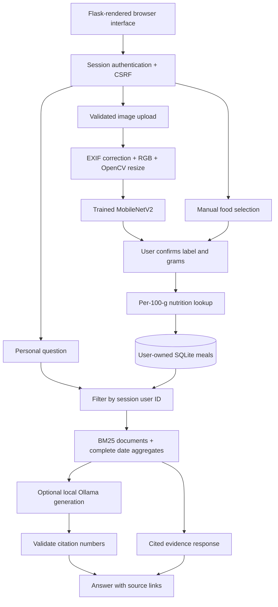

# Architecture

## Request example

1. The session identifies the signed-in account. Routes ignore any supplied `user_id`.
2. The user selects 200 g of cooked rice. The server looks up the catalogue entry.
3. For the current USDA white-rice reference, calories are `129 × 200 / 100 = 258 kcal`. The browser's preview is not trusted.
4. Values, weight, date, entry method and nutrition-source text are saved together.
5. A question about today's calories queries that user's entire date range.
6. BM25 selects up to five relevant meal/profile documents. A complete SQL summary is
   added separately for date questions. The assistant never sums just its top-k evidence.
7. Citations link to the corresponding profile or filtered diary page.

## Privacy boundary

`get_meals`, `summarize`, history, CSV export, and deletion all include the authenticated
owner in their SQL predicates. There is no all-user vector store and no LLM database
tool. Documents are constructed only after owner filtering. Meal IDs in URLs are not
authorization: deletion also checks ownership, and diary access always filters records.

Photos remain in memory for recognition. Notes and model responses are treated as plain
text. Jinja autoescaping and JavaScript `textContent` prevent them from becoming HTML.
The browser sends no requests to third-party CDNs. The configured Ollama server receives
retrieved context; use the local endpoint for local processing.

Updating a profile or deleting a meal clears that user's chat snapshots to avoid serving
outdated evidence. Chat history itself is account-scoped. It is a transcript, not an
additional knowledge source. Fresh questions retrieve fresh records.

Optional adult measurements live in `body_profiles`, keyed to the authenticated user.
The server computes BMI, Mifflin–St Jeor resting energy and an activity-based maintenance
estimate. Saving or removing measurements clears that user's stale chat snapshots.
These estimates do not automatically change the independently editable calorie goal.

## Authentication and deployment

Werkzeug hashes passwords. Cookies are HttpOnly and SameSite=Lax, with optional Secure
for HTTPS deployments. All mutations require CSRF tokens. Login/registration attempts
are limited by account and direct remote IP over 15 minutes. SQLite foreign keys and
parameterized SQL protect data integrity. Uploads have byte and pixel limits.

This is a single-host academic application. It does not implement MFA, email verification,
password-reset email, production observability, distributed rate limiting, database
migrations, or encrypted backups. A deployment engineer should configure those for a
larger service according to actual requirements.

## Retrieval limitations

BM25 is lexical: it does not understand arbitrary synonyms or complex time expressions.
Only the documented periods become SQL date filters. Top-k evidence is a sample, not
a complete answer to arbitrary ranking questions such as “my highest-protein meal ever.”
Each question needs its own explicit context. Ollama improves wording, not evidence
coverage. Citation validation checks references exist; it cannot prove every claim is
supported. Prompt-injection resistance must be evaluated, even with local models.

The nutrition catalogue is independent of model labels: recognition may support more
classes than nutrition estimation. Adding a classifier label does not automatically
create a credible nutrition entry.
